# Linaje de los datos

**Generado por `pipeline/generar_linaje.py` — no editar a mano.** Se reconstruye leyendo el AST de
cada script y anotando que ficheros lee y cuales escribe, asi que describe el pipeline tal como
esta, no como se documento. Volver a ejecutarlo despues de cualquier cambio.

21 scripts, 32 ficheros.

**Llamadas no resueltas:** `bronze/unificar_registros.py` (3), `export/export_criba.py` (1), `export/export_mapa_limpio.py` (1), `export/preparar_geometria_web.py` (2), `gold/modelar_flujos_banda.py` (1), `sources/descargar_fuentes.py` (2), `sources/descargar_ine_barcelona.py` (1), `sources/descargar_serie_vut.py` (2), `sources/geocodificar_registros.py` (1). Son rutas que se componen en tiempo de ejecucion o que llegan como argumento; el grafo no las incluye y por eso se listan aqui en vez de pasar desapercibidas.

```mermaid
flowchart TD
  subgraph raw ["raw · descargas"]
    n_RAIZ_data_raw_airbnb_insideairbnb_barcelona_2026_06_24_listings_csv[("insideairbnb_barcelona_2026-06-24_listings.csv")]
    n_RAIZ_data_raw_airbnb_insideairbnb_barcelona_2026_06_24_listings_detalle_csv_gz[("insideairbnb_barcelona_2026-06-24_listings_detalle.csv.gz")]
    n_RAIZ_data_raw_geometria_icgc_municipis_catalunya_completa_geojson[("icgc_municipis_catalunya_completa.geojson")]
    n_RAIZ_data_raw_geometria_icgc_municipis_provincia_barcelona_geojson[("icgc_municipis_provincia_barcelona.geojson")]
    n_RAIZ_data_raw_geometria_insideairbnb_barrios_barcelona_geojson[("insideairbnb_barrios_barcelona.geojson")]
    n_RAIZ_data_raw_hoteles_opendata_bcn_hotels_snapshot_csv[("opendata_bcn_hotels_snapshot.csv")]
    n_RAIZ_data_raw_ine_portaldades_adr_por_categoria_2013_2026_csv[("portaldades_adr_por_categoria_2013_2026.csv")]
    n_RAIZ_data_raw_registre_turisme_hoteles_y_apartaments_turistics_provincia_barcelona_csv[("hoteles_y_apartaments_turistics_provincia_barcelona.csv")]
    n_RAIZ_data_raw_restauracion_hoteles_provincia_bcn_cens_comercial_restauracion_2024_csv[("bcn_cens_comercial_restauracion_2024.csv")]
    n_RAIZ_data_raw_restauracion_hoteles_provincia_provincia_barcelona_restauracion_osm_2026_csv[("provincia_barcelona_restauracion_osm_2026.csv")]
    n_RAIZ_data_raw_vut_opendata_bcn_hut_2016_2026Q1_csv[("opendata_bcn_hut_2016-2026Q1.csv")]
  end
  subgraph bronze ["bronze · limpio"]
    n_RAIZ_data_bronze_adr_estacionalidad_csv[("adr_estacionalidad.csv")]
    n_RAIZ_data_bronze_adr_por_categoria_csv[("adr_por_categoria.csv")]
    n_RAIZ_data_bronze_airbnb_anuncios_csv[("airbnb_anuncios.csv")]
    n_RAIZ_data_bronze_geocodificacion_icgc_csv[("geocodificacion_icgc.csv")]
    n_RAIZ_data_bronze_geocodificacion_verificada_csv[("geocodificacion_verificada.csv")]
    n_RAIZ_data_bronze_hoteles_geocodificados_csv[("hoteles_geocodificados.csv")]
    n_RAIZ_data_bronze_hoteles_nuevos_bcn_csv[("hoteles_nuevos_bcn.csv")]
    n_RAIZ_data_bronze_hoteles_y_apartaments_unificados_csv[("hoteles_y_apartaments_unificados.csv")]
    n_RAIZ_data_bronze_municipios_provincia_barcelona_geojson[("municipios_provincia_barcelona.geojson")]
    n_RAIZ_data_bronze_restauracion_con_municipio_csv[("restauracion_con_municipio.csv")]
    n_RAIZ_data_bronze_serie_ine_barcelona_csv[("serie_ine_barcelona.csv")]
    n_RAIZ_data_bronze_serie_vut_trimestral_csv[("serie_vut_trimestral.csv")]
    n_RAIZ_data_bronze_titulares_csv[("titulares.csv")]
  end
  subgraph gold ["gold · transformado"]
    n_RAIZ_data_gold_airbnb_excluidos_web_csv[("airbnb_excluidos_web.csv")]
    n_RAIZ_data_gold_airbnb_para_web_csv[("airbnb_para_web.csv")]
    n_RAIZ_data_gold_alojamientos_reglados_csv[("alojamientos_reglados.csv")]
    n_RAIZ_data_gold_hoteles_bcn_csv[("hoteles_bcn.csv")]
    n_RAIZ_data_gold_restauracion_bcn_csv[("restauracion_bcn.csv")]
  end
  subgraph otros ["sin capa"]
    n_RAIZ_docs_criba_md[("criba.md")]
    n_RAIZ_docs_diccionario_md[("diccionario.md")]
    n_RAIZ_docs_linaje_md[("linaje.md")]
  end
  subgraph scripts ["scripts"]
    n_bronze_asignar_municipio_py["bronze/asignar_municipio.py"]
    n_bronze_preparar_adr_por_categoria_py["bronze/preparar_adr_por_categoria.py"]
    n_bronze_reparar_geometria_municipios_py["bronze/reparar_geometria_municipios.py"]
    n_bronze_unificar_airbnb_py["bronze/unificar_airbnb.py"]
    n_bronze_unificar_registros_py["bronze/unificar_registros.py"]
    n_export_export_criba_py["export/export_criba.py"]
    n_export_export_mapa_limpio_py["export/export_mapa_limpio.py"]
    n_export_preparar_geometria_web_py["export/preparar_geometria_web.py"]
    n_generar_criba_py["generar_criba.py"]
    n_generar_diccionario_py["generar_diccionario.py"]
    n_gold_modelar_flujos_banda_py["gold/modelar_flujos_banda.py"]
    n_gold_modelo_py["gold/modelo.py"]
    n_gold_preparar_alojamientos_provincia_py["gold/preparar_alojamientos_provincia.py"]
    n_gold_preparar_hoteles_bcn_py["gold/preparar_hoteles_bcn.py"]
    n_gold_preparar_restauracion_bcn_py["gold/preparar_restauracion_bcn.py"]
    n_gold_separar_sin_registro_py["gold/separar_sin_registro.py"]
    n_sources_descargar_fuentes_py["sources/descargar_fuentes.py"]
    n_sources_descargar_ine_barcelona_py["sources/descargar_ine_barcelona.py"]
    n_sources_descargar_serie_vut_py["sources/descargar_serie_vut.py"]
    n_sources_geocodificar_hoteles_py["sources/geocodificar_hoteles.py"]
    n_sources_geocodificar_registros_py["sources/geocodificar_registros.py"]
  end
  n_RAIZ_data_bronze_geocodificacion_icgc_csv --> n_bronze_asignar_municipio_py
  n_RAIZ_data_bronze_municipios_provincia_barcelona_geojson --> n_bronze_asignar_municipio_py
  n_RAIZ_data_raw_geometria_insideairbnb_barrios_barcelona_geojson --> n_bronze_asignar_municipio_py
  n_RAIZ_data_raw_restauracion_hoteles_provincia_provincia_barcelona_restauracion_osm_2026_csv --> n_bronze_asignar_municipio_py
  n_bronze_asignar_municipio_py --> n_RAIZ_data_bronze_geocodificacion_verificada_csv
  n_bronze_asignar_municipio_py --> n_RAIZ_data_bronze_restauracion_con_municipio_csv
  n_RAIZ_data_raw_ine_portaldades_adr_por_categoria_2013_2026_csv --> n_bronze_preparar_adr_por_categoria_py
  n_bronze_preparar_adr_por_categoria_py --> n_RAIZ_data_bronze_adr_estacionalidad_csv
  n_bronze_preparar_adr_por_categoria_py --> n_RAIZ_data_bronze_adr_por_categoria_csv
  n_RAIZ_data_raw_geometria_icgc_municipis_provincia_barcelona_geojson --> n_bronze_reparar_geometria_municipios_py
  n_bronze_reparar_geometria_municipios_py --> n_RAIZ_data_bronze_municipios_provincia_barcelona_geojson
  n_RAIZ_data_raw_airbnb_insideairbnb_barcelona_2026_06_24_listings_csv --> n_bronze_unificar_airbnb_py
  n_RAIZ_data_raw_airbnb_insideairbnb_barcelona_2026_06_24_listings_detalle_csv_gz --> n_bronze_unificar_airbnb_py
  n_bronze_unificar_airbnb_py --> n_RAIZ_data_bronze_airbnb_anuncios_csv
  n_RAIZ_data_bronze_titulares_csv --> n_bronze_unificar_registros_py
  n_bronze_unificar_registros_py --> n_RAIZ_data_bronze_titulares_csv
  n_RAIZ_data_gold_airbnb_excluidos_web_csv --> n_export_export_criba_py
  n_RAIZ_data_gold_airbnb_para_web_csv --> n_export_export_criba_py
  n_RAIZ_data_bronze_hoteles_nuevos_bcn_csv --> n_export_export_mapa_limpio_py
  n_RAIZ_data_bronze_serie_vut_trimestral_csv --> n_export_export_mapa_limpio_py
  n_RAIZ_data_gold_airbnb_excluidos_web_csv --> n_export_export_mapa_limpio_py
  n_RAIZ_data_gold_airbnb_para_web_csv --> n_export_export_mapa_limpio_py
  n_RAIZ_data_gold_alojamientos_reglados_csv --> n_export_export_mapa_limpio_py
  n_RAIZ_data_gold_restauracion_bcn_csv --> n_export_export_mapa_limpio_py
  n_RAIZ_data_raw_registre_turisme_hoteles_y_apartaments_turistics_provincia_barcelona_csv --> n_export_export_mapa_limpio_py
  n_RAIZ_data_raw_vut_opendata_bcn_hut_2016_2026Q1_csv --> n_export_export_mapa_limpio_py
  n_RAIZ_data_gold_airbnb_excluidos_web_csv --> n_generar_criba_py
  n_RAIZ_data_gold_airbnb_para_web_csv --> n_generar_criba_py
  n_generar_criba_py --> n_RAIZ_docs_criba_md
  n_RAIZ_docs_linaje_md --> n_generar_diccionario_py
  n_generar_diccionario_py --> n_RAIZ_docs_diccionario_md
  n_RAIZ_data_gold_airbnb_para_web_csv --> n_gold_modelo_py
  n_RAIZ_data_gold_alojamientos_reglados_csv --> n_gold_modelo_py
  n_RAIZ_data_bronze_geocodificacion_verificada_csv --> n_gold_preparar_alojamientos_provincia_py
  n_RAIZ_data_bronze_hoteles_y_apartaments_unificados_csv --> n_gold_preparar_alojamientos_provincia_py
  n_RAIZ_data_gold_hoteles_bcn_csv --> n_gold_preparar_alojamientos_provincia_py
  n_gold_preparar_alojamientos_provincia_py --> n_RAIZ_data_gold_alojamientos_reglados_csv
  n_RAIZ_data_bronze_geocodificacion_verificada_csv --> n_gold_preparar_hoteles_bcn_py
  n_RAIZ_data_bronze_hoteles_geocodificados_csv --> n_gold_preparar_hoteles_bcn_py
  n_RAIZ_data_bronze_hoteles_y_apartaments_unificados_csv --> n_gold_preparar_hoteles_bcn_py
  n_RAIZ_data_raw_geometria_insideairbnb_barrios_barcelona_geojson --> n_gold_preparar_hoteles_bcn_py
  n_RAIZ_data_raw_hoteles_opendata_bcn_hotels_snapshot_csv --> n_gold_preparar_hoteles_bcn_py
  n_gold_preparar_hoteles_bcn_py --> n_RAIZ_data_gold_hoteles_bcn_csv
  n_RAIZ_data_raw_restauracion_hoteles_provincia_bcn_cens_comercial_restauracion_2024_csv --> n_gold_preparar_restauracion_bcn_py
  n_gold_preparar_restauracion_bcn_py --> n_RAIZ_data_gold_restauracion_bcn_csv
  n_RAIZ_data_gold_airbnb_excluidos_web_csv --> n_gold_separar_sin_registro_py
  n_RAIZ_data_gold_airbnb_para_web_csv --> n_gold_separar_sin_registro_py
  n_gold_separar_sin_registro_py --> n_RAIZ_data_gold_airbnb_excluidos_web_csv
  n_gold_separar_sin_registro_py --> n_RAIZ_data_gold_airbnb_para_web_csv
  n_RAIZ_data_raw_geometria_icgc_municipis_catalunya_completa_geojson --> n_sources_descargar_fuentes_py
  n_sources_descargar_fuentes_py --> n_RAIZ_data_raw_geometria_icgc_municipis_provincia_barcelona_geojson
  n_sources_descargar_ine_barcelona_py --> n_RAIZ_data_bronze_serie_ine_barcelona_csv
  n_sources_descargar_serie_vut_py --> n_RAIZ_data_bronze_serie_vut_trimestral_csv
  n_RAIZ_data_bronze_hoteles_y_apartaments_unificados_csv --> n_sources_geocodificar_hoteles_py
  n_sources_geocodificar_hoteles_py --> n_RAIZ_data_bronze_hoteles_geocodificados_csv
  n_RAIZ_data_bronze_geocodificacion_icgc_csv --> n_sources_geocodificar_registros_py
  n_sources_geocodificar_registros_py --> n_RAIZ_data_bronze_geocodificacion_icgc_csv
```

## Dependencias por script

| Script | Capa | Lee | Escribe |
|---|---|---|---|
| `bronze/asignar_municipio.py` | bronze | geocodificacion_icgc.csv municipios_provincia_barcelona.geojson insideairbnb_barrios_barcelona.geojson provincia_barcelona_restauracion_osm_2026.csv | geocodificacion_verificada.csv restauracion_con_municipio.csv |
| `bronze/preparar_adr_por_categoria.py` | bronze | portaldades_adr_por_categoria_2013_2026.csv | adr_estacionalidad.csv adr_por_categoria.csv |
| `bronze/reparar_geometria_municipios.py` | bronze | icgc_municipis_provincia_barcelona.geojson | municipios_provincia_barcelona.geojson |
| `bronze/unificar_airbnb.py` | bronze | insideairbnb_barcelona_2026-06-24_listings.csv insideairbnb_barcelona_2026-06-24_listings_detalle.csv.gz | airbnb_anuncios.csv |
| `bronze/unificar_registros.py` | bronze | titulares.csv | titulares.csv |
| `export/export_criba.py` | export | airbnb_excluidos_web.csv airbnb_para_web.csv | — |
| `export/export_mapa_limpio.py` | export | hoteles_nuevos_bcn.csv serie_vut_trimestral.csv airbnb_excluidos_web.csv airbnb_para_web.csv alojamientos_reglados.csv restauracion_bcn.csv hoteles_y_apartaments_turistics_provincia_barcelona.csv opendata_bcn_hut_2016-2026Q1.csv | — |
| `export/preparar_geometria_web.py` | export | — | — |
| `generar_criba.py` | generar_criba.py | airbnb_excluidos_web.csv airbnb_para_web.csv | criba.md |
| `generar_diccionario.py` | generar_diccionario.py | linaje.md | diccionario.md |
| `gold/modelar_flujos_banda.py` | gold | — | — |
| `gold/modelo.py` | gold | airbnb_para_web.csv alojamientos_reglados.csv | — |
| `gold/preparar_alojamientos_provincia.py` | gold | geocodificacion_verificada.csv hoteles_y_apartaments_unificados.csv hoteles_bcn.csv | alojamientos_reglados.csv |
| `gold/preparar_hoteles_bcn.py` | gold | geocodificacion_verificada.csv hoteles_geocodificados.csv hoteles_y_apartaments_unificados.csv insideairbnb_barrios_barcelona.geojson opendata_bcn_hotels_snapshot.csv | hoteles_bcn.csv |
| `gold/preparar_restauracion_bcn.py` | gold | bcn_cens_comercial_restauracion_2024.csv | restauracion_bcn.csv |
| `gold/separar_sin_registro.py` | gold | airbnb_excluidos_web.csv airbnb_para_web.csv | airbnb_excluidos_web.csv airbnb_para_web.csv |
| `sources/descargar_fuentes.py` | sources | icgc_municipis_catalunya_completa.geojson | icgc_municipis_provincia_barcelona.geojson |
| `sources/descargar_ine_barcelona.py` | sources | — | serie_ine_barcelona.csv |
| `sources/descargar_serie_vut.py` | sources | — | serie_vut_trimestral.csv |
| `sources/geocodificar_hoteles.py` | sources | hoteles_y_apartaments_unificados.csv | hoteles_geocodificados.csv |
| `sources/geocodificar_registros.py` | sources | geocodificacion_icgc.csv | geocodificacion_icgc.csv |
